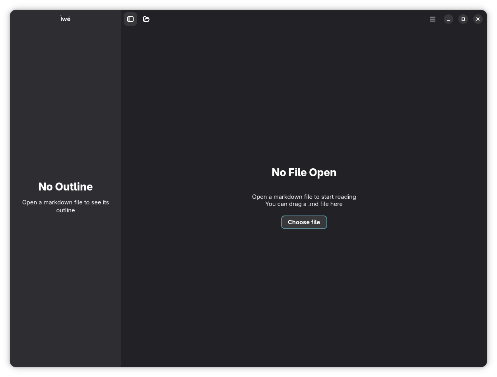
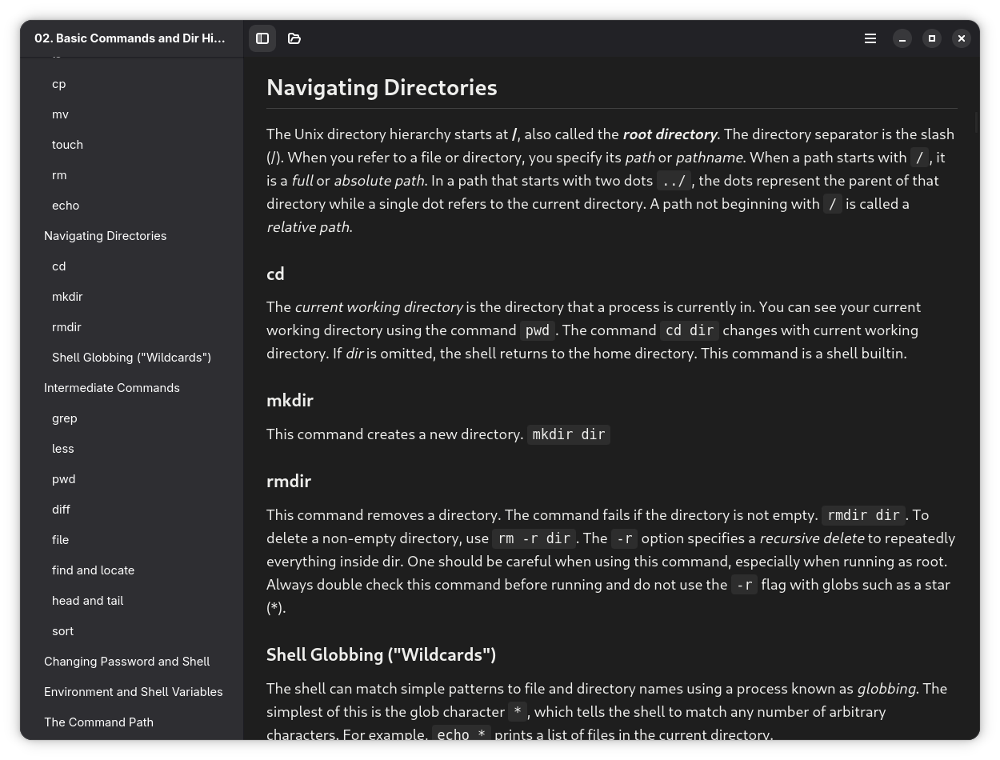

# Ìwé

Ìwé is a native Markdown viewer for the GNOME desktop. It shows Markdown
files in a clean, read-only view. The name comes from the Yoruba word for
book.

## Features

- Renders Markdown with tables, fenced code blocks, and a table of contents.
- Shows an outline of the headings in a sidebar.
- Opens a file with the Open button, drag and drop, the command line, or the
  file manager.
- Reloads the document when the file changes on disk.
- Keeps the scroll position after a reload.
- Follows the system light and dark theme.
- Opens web links in the default browser.
- Registers as an application for `text/markdown` files.

## Screenshots

| Welcome page | Document view |
| --- | --- |
|  |  |

The screenshots show the dark theme.

## Requirements

- Python 3 and PyGObject
- GTK 4
- libadwaita
- WebKitGTK 6.0
- Python Markdown package (`markdown`)
- Meson 1.0 or later
- blueprint-compiler
- gettext
- desktop-file-utils and appstreamcli for the tests

Package names are different on each distribution. Use your distribution
package manager to install these dependencies.

## Build from source

Configure the build:

```sh
meson setup _build --prefix=/usr/local
```

Compile the project:

```sh
meson compile -C _build
```

Install the application:

```sh
sudo meson install -C _build
```

Start the application:

```sh
iwe
```

Open a file from the command line:

```sh
iwe path/to/document.md
```

## Flatpak

The project includes the Flatpak manifest `com.enoch02.iwe.json`. The
manifest uses the `org.gnome.Platform` 50 runtime.

Install the runtime and SDK:

```sh
flatpak install flathub org.gnome.Platform//50 org.gnome.Sdk//50
```

The manifest source points to a local checkout. Update the `sources` entry
before you build on another machine.

Build and install the application:

```sh
flatpak-builder --user --install --force-clean build-dir com.enoch02.iwe.json
```

Start the Flatpak:

```sh
flatpak run com.enoch02.iwe
```

Use the Flatpak extension in Visual Studio Code to export a bundle. See
"Use with Visual Studio Code" below.

## Use with Visual Studio Code

Install these extensions:

- Meson (`mesonbuild.mesonbuild`)
- Flatpak (`bilelmoussaoui.flatpak-vscode`)

The workspace uses `_build` as the Meson build folder. The Meson extension
uses `.flatpak/meson.sh` from the workspace settings.

Open the Command Palette with `Ctrl+Shift+P`. Use these commands:

- **Flatpak: Select or Change Active Manifest**: Select
  `com.enoch02.iwe.json`.
- **Flatpak: Build**: Build the application.
- **Flatpak: Build and Run**: Build and start the application.
- **Flatpak: Export Bundle**: Create `com.enoch02.iwe.flatpak` in the
  workspace root.
- **Flatpak: Show Output Terminal**: Show the build output.

The export command needs a successful build. Run **Flatpak: Build** first.
The command writes `com.enoch02.iwe.flatpak` to the workspace root.

Install the exported bundle:

```sh
flatpak install --user ./com.enoch02.iwe.flatpak
```

**Meson: Build** only compiles targets in the SDK. It does not create a
Flatpak bundle. If the target list appears, select **Build all targets**.

## File association

The desktop file declares the `text/markdown` MIME type. The application
handles open requests from the file manager and the command line.

For Flatpak, the desktop file sets `DBusActivatable=false`. The application
starts through `Exec`. Flatpak can then export the opened file to the
document portal. Do not enable D-Bus activation. A sandboxed application
cannot read the original host path.

## Tests

Run the test suite:

```sh
meson test -C _build
```

The tests validate the desktop file, the AppStream metadata, and the
GSettings schema.

## Project structure

```text
data/          Desktop entry, AppStream data, GSettings schema, D-Bus service, icons
po/            Translations
src/           Python sources and Blueprint UI files
subprojects/   Build dependencies
```

## Translations

Extract the translatable strings:

```sh
meson compile -C _build iwe-pot
```

Update the translation files:

```sh
meson compile -C _build iwe-update-po
```

## Contributing

Report bugs and request features in the GitHub issue tracker:
<https://github.com/Enoch02/Iwe/issues>

Run the tests before you send a change.

## License

Ìwé is licensed under the GNU General Public License version 3 or later.
See `COPYING` for the full license text.
